# Practice Assignment 2: Linked Lists & Trees

These questions should be completed without Googling the answer, which in most cases is easily available on the internet. That would defeat the point of the assignment, which is for *you* to practice interviewing skills. You use your own knowledge as it stands. There are two exceptions to this rule. Firstly, if you are unsure of syntax (e.g., method names, constructor arguments, etc.), you may look it up. Secondly, if you do not know a term, you may look it up. In some cases, depending on your academic schedule, you may not yet have covered a data structure yet, in which case we *encourage* you to learn and study the general concepts *before* attempting the problem.

Some questions may seem vague. This is intentional, as interview questions are often vague. Avoid making unnecessary assumptions, including based on example input/output, which is not exhaustive. If you *must* make an assumption, state your assumption in a comment in your code.

## Part 1: Data Structure Implementations (~2 hrs, 40 min)

### Instructions

For each problem, implement the data structure from scratch (i.e., not using the built-in version in your language of choice even if one exists) according to the provided API. For each method, please indicate the time complexity of your implementation in a comment.

If you are unfamiliar with any of the data structures you are asked to implement, please read the appropriate article defining the data structure listed below before attempting the problem. You’re welcome to consult other internet resources on the definition and use cases of these data structures, but **do not** read any implementations before attempting these problems. (If you’ve seen or created implementations in the past, of course that’s okay, but do these problems without consulting them.) Even if you do not do the bonus questions, make sure you are familiar with the data structures because you will need them for Part 2 of the assignment.

- [Linked Lists](https://www.geeksforgeeks.org/introduction-to-linked-list-data-structure-and-algorithm-tutorial/) (Questions 1-2)
- [Tree Traversals](https://www.geeksforgeeks.org/tree-traversals-inorder-preorder-and-postorder/) (Question 3; Part 2)
- [Binary Search Trees](https://www.geeksforgeeks.org/binary-search-tree-data-structure/) (Question 3)
    - BST operations [visualization](https://www.cs.usfca.edu/~galles/visualization/BST.html)
- [Queues](https://www.geeksforgeeks.org/queue-data-structure/) (Bonus Question 1)
- [Stacks](https://www.geeksforgeeks.org/stack-data-structure/) (Bonus Question 2)

You also might find the videos such as the following helpful for visualizing recursion and the tree traversals:

- [Recursion](https://www.youtube.com/watch?v=9aBXuEL7I5A)
- [Pre-order traversal](https://www.youtube.com/watch?v=8xue-ZBlTKQ)
- [In-order traversal](https://www.youtube.com/watch?v=4_UDUj1j1KQ&t=128s)
- [Post-order traversal](https://www.youtube.com/watch?v=4Xo-GtBiQN0)

The core implementations do not have a maximum time; you will need them to understand in order to do the rest of the assignment. If you are stuck after 40 min, please get help from your mentor and/or consult resources. If you do need to consult other resources, be sure to then re-implement what you learn on your own without consulting resources while coding.

### Question 1: Singly Linked List (40 min max)

Implement the following methods. Rather than having a separate linked list class, we will pass a Node struct that represents the head of the list (this is common practice in interview questions). The linked list article includes a Node struct definition in a number of common languages (C++, Python, Java, JavaScript); feel free to use it in your implementation. For simplicity, you can make your nodes store integers rather than generic data types. In each of the methods, you should use pointers in languages that support pointers (e.g., Node \* in C++) or a reference in languages that support references (e.g., Python).

```cpp
struct Node {
  int data
  Node next
}

Node insertAtFront(Node head, int val) // creates new Node with data val at front; returns head. O(1) time.
Node insertAtBack(Node head int val) // creates new Node with data val at end; returns head. O(n) time.
Node insertAfter(Node head, int val, Node loc) // creates new Node with data val after Node loc; returns head. O(1) time.
Node insertBefore(Node head, int val, Node loc) // creates new Node with data val before Node loc; returns head. O(n) time.
Node deleteFront(Node head) // removes first Node; returns head. O(1) time.
Node deleteBack(Node head) // removes last Node; returns head. O(n) time.
Node deleteNode(Node head, Node loc) // deletes Node loc; returns head. O(n) time.
int length(Node head) // returns length of the list. O(n) time.
Node reverseIterative(Node head) // reverses the linked list iteratively. O(n) time.
Node reverseRecursive(Node head) // reverses the linked list recursively (Hint: you will need a helper function.) O(n) time.
```

### Question 2: Doubly Linked List (20 min max)

Copy-paste your singly linked list implementation and modify it. Your Node struct should have an additional prev reference as well as a next.

```text
struct Node {
  int data
  Node next
  Node prev
}

Node insertAtFront(Node head, int val) // creates new Node with data val at front; returns head. O(1) time.
Node insertAtBack(Node head, Node tail, int val) // creates new Node with data val at end; returns head. O(1) time.
Node insertAfter(Node head, int val, Node loc) // creates new Node with data val after Node loc; returns head. O(1) time.
Node insertBefore(Node head, int val, Node loc) // creates new Node with data val before Node loc; returns head. O(1) time.
Node deleteFront(Node head) // removes first Node; returns head. O(1) time.
Node deleteBack(Node head, Node tail) // removes last Node; returns head. O(1) time.
Node deleteNode(Node head, Node loc) // deletes Node loc; returns head. O(1) time.
int length(Node head) // returns length of the list. O(n) time.
Node reverseIterative(Node head) // reverses the linked list iteratively. O(n) time.
Node reverseRecursive(Node head) // reverses the linked list recursively (Hint: you will need a helper function.)  O(n) time.
```

### Question 3: Binary Search Tree (40 min max)

In each of the methods, use pointers in languages that support pointers (e.g., Node \* in C++) or references in languages that support references (e.g., Python). Your Node struct will be the same as for your doubly linked list except the two pointers/references should be left and right rather than next and prev. Note that the delete method is more difficult than the insert method; you won’t need it for the rest of the assignment so either stop or get help from your mentor if you are stuck after 40 minutes.

```cpp
struct Node {
  int data
  Node left
  Node right
}

class BinarySearchTree {
  private:
    Node root

  public:
    int min() // returns the minimum value in the BST.  O(logn) time.
    int max() // returns the maximum value in the BST.  O(logn) time.
    bool contains(int val) // returns a boolean indicating whether val is present in the
                              BST.  O(logn) time.
    void insert(int val) // creates a new Node with data val in the appropriate location.
                            For simplicity, do not allow duplicates. If val is already
                            present, insert is a no-op. O(logn) time.
    void delete(int val) // deletes the Node with data val, if it exists. O(logn) time.
}
```

### Question 4: Queue (20 min max)

Queues are not a “first-class” data structure – they are an API or interface implemented using another underlying data structure. Queues should have O(1) insertion and deletion; because insertion and deletion occur at opposite ends, the underlying data structure is normally a linked list to satisfy this requirement. Implement a queue class according to the following definition; you may copy-paste and reuse any parts of your solution to Question 1 or 2. Again, for simplicity, you can make your queue store integers rather than generic data types. Queues are necessary auxiliary data structures to implement breadth-first traversals of graphs and trees. For those problems, you should use your language’s built-in; we are asking you to implement a queue here for two reasons: to demonstrate one of the use cases of linked lists and to give you an understanding of how they work.

```text
class Queue {
    int peek() // returns the first item in the queue. O(1) time.
    void enqueue(int x) // adds x to the back of the queue. O(1) time.
    int dequeue() // removes and returns the first item in the queue. O(1) time.
    bool isEmpty() // returns a boolean indicating whether the queue is empty. O(1) time.
}
```

### Question 5: Stack (20 min max)

Stacks are also not a “first-class” data structure and should also have O(1) insertion and deletion. Because insertion and deletion occur at the same end, this can be achieved with either an array or a linked list. Implement a queue class according to the following definition using a linked list as the underlying data structure; you may copy-paste and reuse any parts of your solution to Question 1 or 2. Again, for simplicity, you can make your stack store integers rather than generic data types. You will likely implement your depth-first traversals of graphs and trees recursively; however, if you chose to do them iteratively, you would need to use a stack.

```text
class Stack {
    int top() // returns the top item in the stack. O(1) time.
    void push(int x) // adds x to the top of the stack. O(1) time.
    int pop() // removes and returns the top item in the stack. O(1) time.
    bool isEmpty() // returns a boolean indicating whether the stack is empty. O(1) time.
}
```

### Question 6: Deque (20 min max)

Finally, dequeues (short for double-ended queues) are another “non-first-class” data structure that have the features of both stacks and queues: O(1) insertion and deletion at both ends. Implement a deque class according to the following definition; you may copy-paste and reuse any parts of your solution to Question 1 or 2. As usual, for simplicity, you can make your dequeue store integers rather than generic data types.

```text
class Deque {
    int front() // returns the first item in the deque. O(1) time.
    int back() // returns the last item in the deque. O(1) time.
    void pushBack(int x) // adds x to the back of the deque. O(1) time.
    void pushFront(int x) // adds x to the front of the deque. O(1) time.
    int popFront() // removes and returns the first item in the deque. O(1) time.
    int popBack() // removes and returns the last item in the deque. O(1) time.
    bool isEmpty() // returns a boolean indicating whether the deque is empty. O(1) time.
}
```

\
-

## Part 2: Linked List & Tree Problems (~5 hrs, 20 min)

### Instructions

For each problem, identify the appropriate linked list or tree technique from Workshop 2. **State the technique in a comment at the top of your file**. As a reminder, the options are:

> **Linked List Two Pointer Techniques:**

1. Linked list fast-slow two-pointer
2. Linked list fixed-distance two-pointer
3. Linked list reset/catch-up two-pointer
4. Simultaneous iteration two-pointer
5. Doubly linked list forward-backward two-pointer

**Other Linked List Techniques:**

1. Hash linked list nodes
2. Linked list recursion

    **Tree Traversal Techniques:**

<!-- -->

1. Depth-first traversal
    1. Pre-order
    2. In-order
    3. Post-order
    4. Generic (type doesn’t matter – all work)
2. Level-order (breadth-first) traversal
3. Search binary search tree (BST)

Then, write a function to solve the problem and write test cases to check your function. When run, the file you submit should execute your function on your test cases (e.g., through a main method, if applicable in your language). **State the time and space complexity of your solution in a comment at the top of your file**.

Time how long you spend on each problem. You should actively **work on each problem for a MAXIMUM of 40 minutes**. Once 40 minutes has elapsed, submit whatever you have, regardless of whether you are finished. Please indicate in a comment at the bottom of your file how long you spent on the problem. It is important that you are honest about how long each problem took you as it will help your mentor help you!

### Question 7: CopyTree

Given a binary tree, create a deep copy. Return the root of the new tree.

### Question 8: IsBST

Given a binary tree, determine if it is a binary search tree.

Examples:

Input:

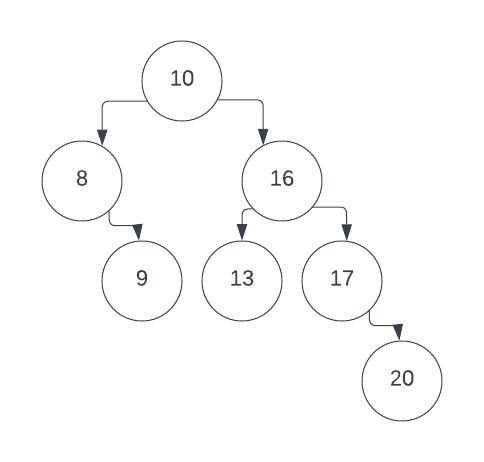{ width="202" }

Output: True

Input:

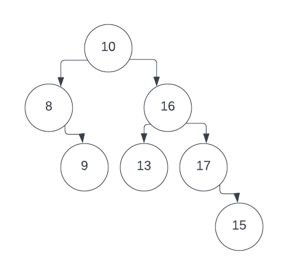{ width="204" }

Output: False

### Question 9: DedupSortedList

Given a sorted singly linked list, remove any duplicates so that no value appears more than once.

Examples:

Input:

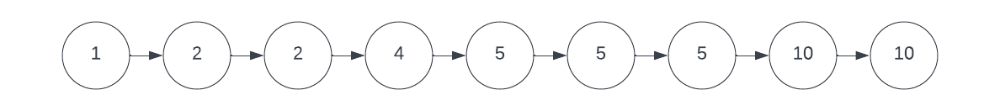{ width="590" }

Output:

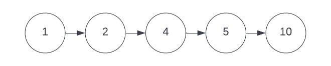{ width="322" }

Input:

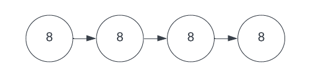{ width="257" }

Output:

{ width="71" }

### Question 10: MoveNthLastToFront

Given a singly linked list, move the nth from the last element to the front of the list.

Examples:

Input: k=2

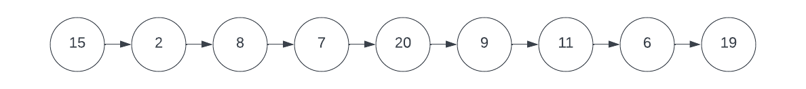{ width="610" }

Output:

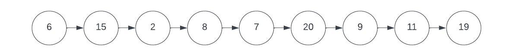{ width="610" }

Input:k=7

{ width="610" }

Output:

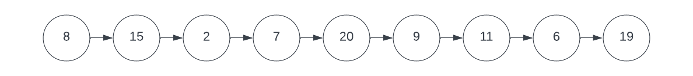{ width="610" }

### Question 11: IsPalindrome

Given a doubly linked list, determine if it is a palindrome.

Examples:

Input:

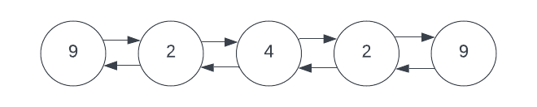{ width="391" }

Output: True

Input:

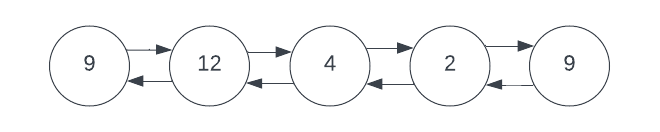{ width="382" }

Output: False

### Question 12: DisconnectCycle

Given a singly linked list, disconnect the cycle, if one exists.

Examples:

Input:

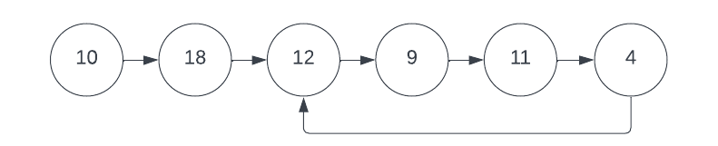{ width="430" }

Output:

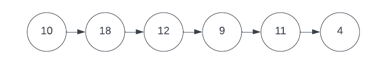{ width="434" }

Input:

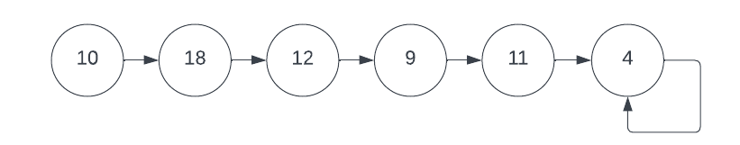{ width="435" }

Output:

{ width="430" }

### Question 13: LeftView

Given a binary tree, create an array of the left view (leftmost elements in each level) of the tree.

Examples:

Input:

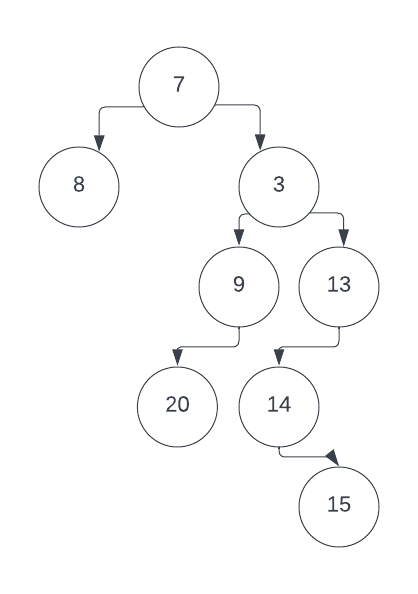{ width="210" }

Output: [7, 8, 9, 20, 15]

Input:

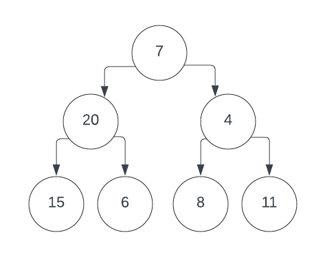{ width="243" }

Output: [7, 20, 15]

### Question 14: FloorInBST

Given a target numeric value and a binary search tree, return the floor (greatest element less than or equal to the target) in the BST.

Examples:

Input: target=13

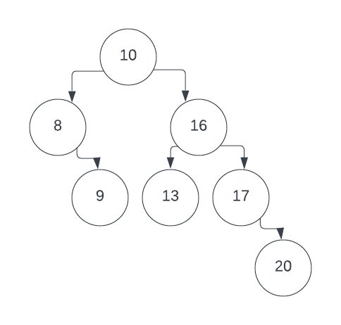{ width="232" }

Output: 13

Input: target=15

{ width="232" }

Output: 13
